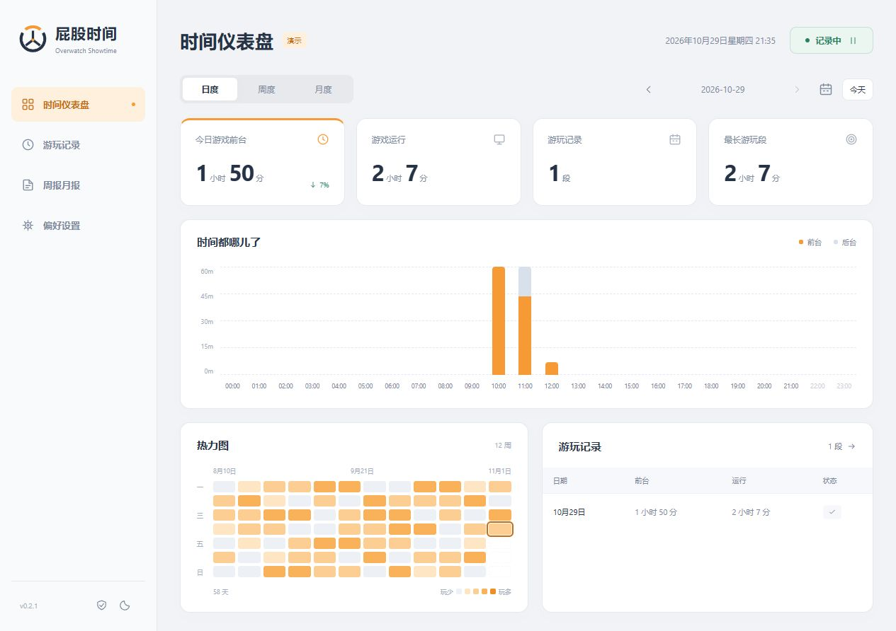
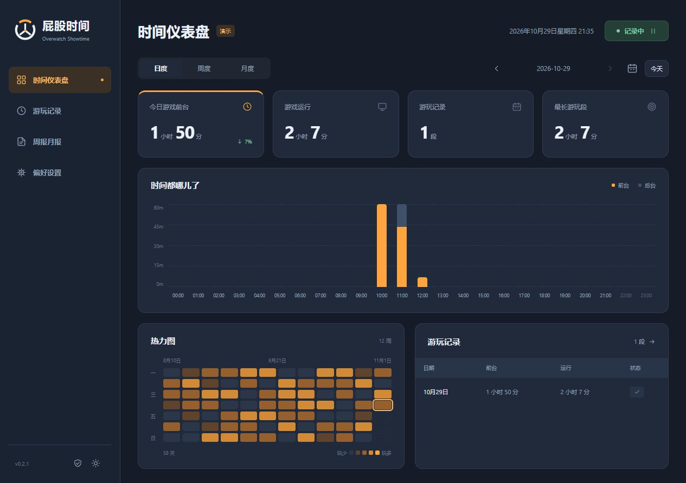
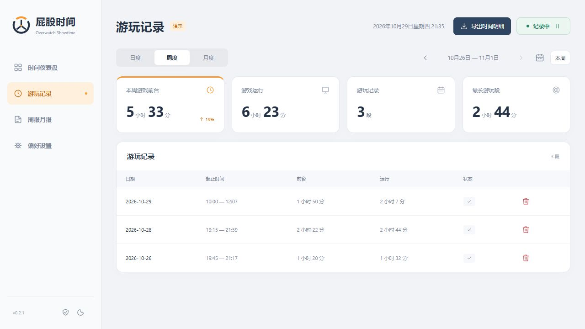
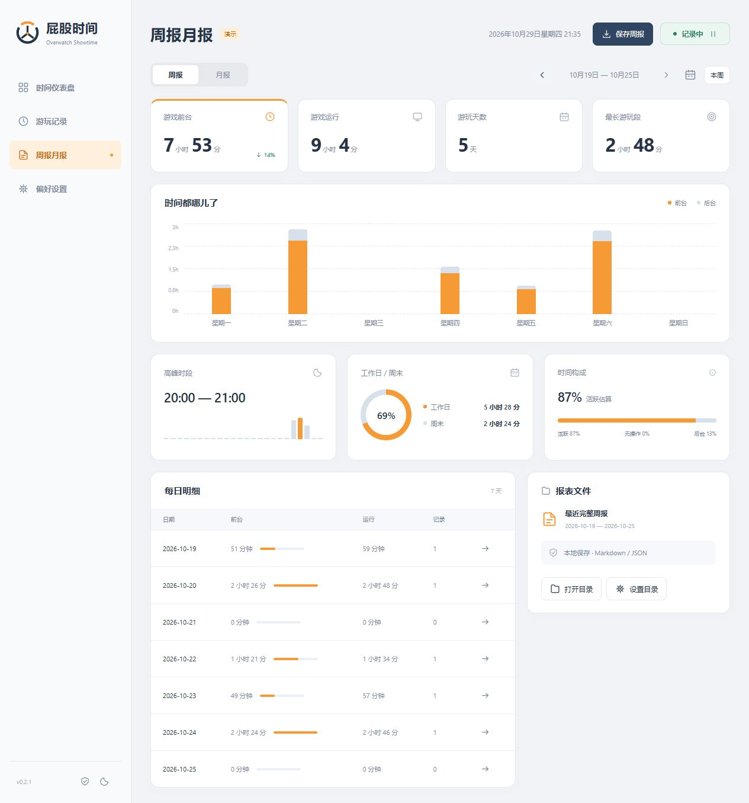
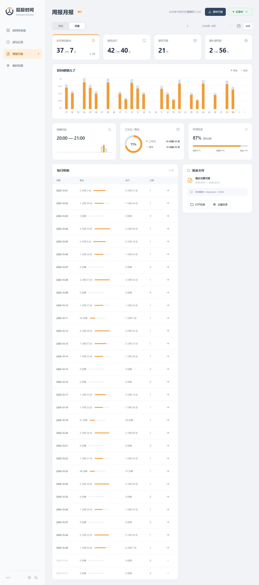

# 屁股时间 · Overwatch Showtime v0.2.1

Windows 10 / 11 x64 守望先锋游戏时间记录工具。自动记录运行、前台及疑似无操作时长，提供日／周／月统计、热力图和本地报表。

打开游戏自动记录，退出后自动结算；平时收在托盘，需要时查看今天玩了多久、最近的游玩习惯和周报月报。无需登录游戏账号，记录保存在本地。

[下载最新版](https://github.com/GirderZ/OverwatchShowtime/releases/latest) · [Agent 安装](#交给-agent-安装) · [更多界面](#界面预览)



> 所有截图均为 v0.2.1 演示模式的虚构数据，不包含个人游玩记录、账号或电脑信息。

| 想知道什么 | 在哪里看 |
| --- | --- |
| 今天玩了多久，切到后台多久？ | 时间仪表盘：前台／运行时长、24 小时分布 |
| 哪天玩得多，最近是否经常玩？ | 12 周热力图，点击日期联动查看 |
| 每次几点开始、几点结束？ | 游玩记录，可按周期查看并导出 CSV |
| 一周／一个月的游玩习惯？ | 周报月报：趋势、高峰时段、工作日／周末和时间构成 |

## 下载与安装

前往 [最新版本 Releases](https://github.com/GirderZ/OverwatchShowtime/releases/latest)，按需选择：

| 方式 | 文件／入口 | 使用方法 |
| --- | --- | --- |
| 安装版 | `OverwatchShowtime-版本-Setup-x64.exe` | 双击安装，选择目录；创建桌面和开始菜单快捷方式，可在 Windows 设置中卸载 |
| 免安装版 | `OverwatchShowtime-版本-Windows-x64.zip` | 完整解压到长期保留的目录，运行 `OverwatchTime.exe` |
| agent 一键安装 | `install.ps1` | 下载发行版脚本后执行下方命令，校验安装包并静默安装 |

无需 Node.js 或 Python。统计数据保存在 `%APPDATA%\OverwatchTime\data`，安装版和免安装版兼容。升级前请从托盘退出旧版。不要同时运行多份程序。

### 交给 agent 安装

可以直接向能够操作 Windows 的 agent 发送：

> 帮我安装 https://github.com/GirderZ/OverwatchShowtime 的最新稳定版。阅读仓库 AGENTS.md 和 scripts/install.ps1，下载发行版安装脚本，检查后执行，保留已有游玩记录。

也可以下载 Release 中的 `install.ps1` 后，在 PowerShell 中执行：

```powershell
powershell.exe -NoProfile -ExecutionPolicy Bypass -File .\install.ps1
# 指定版本；如需安装后打开，加 -Launch
powershell.exe -NoProfile -ExecutionPolicy Bypass -File .\install.ps1 -Version v0.2.1 -Launch
```

脚本使用 GitHub Releases 下载、校验 SHA-256，默认安装到 `%LOCALAPPDATA%\Programs\OverwatchShowtime`，无需管理员权限。支持 `-InstallDir` 自定义安装目录。无网络或无法访问 GitHub 时，可手动下载免安装 ZIP。

当前发行版未配置代码签名，Windows 可能显示未知发布者。真实游戏识别、锁屏、休眠和系统通知的验收边界见 [VALIDATION.md](VALIDATION.md)。

## 界面预览

以下均为示例数据；点击图片可查看原图。

### 深色主题

浅色和深色主题可随时切换，记录状态与图表保持一致。



### 游玩记录

查看每次游玩的起止时间、前台与运行时长，按日／周／月筛选，并导出时间明细。



### 周报月报

一页查看周期趋势、游玩天数、高峰时段、工作日／周末分布和时间构成，支持保存 Markdown／JSON 报表。



<details>
<summary>展开查看月报完整截图（自然月趋势与每日明细）</summary>



</details>

## 从源码构建

需要 Windows x64、Node.js 22.12+ 与 npm：

```powershell
npm ci
npm test
npm start
npm run release:win
```

`release/` 输出安装包、免安装 ZIP、`install.ps1` 和 `SHA256SUMS.txt`。`dist/` 保存未压缩应用。首次构建需下载 Electron、NSIS 等官方构建组件。

维护者向 main 推送 package.json 版本更新，或推送同名 `vX.Y.Z` 标签后，GitHub Actions 自动运行测试并发布下载附件；已存在的发行版本不会被覆盖。手动执行 workflow 仅生成构建附件。源码当前保留全部权利（UNLICENSED），未授予开源许可。第三方运行时许可随发行包提供。

## 升级

先从系统托盘退出旧版，再解压新版并运行。应用继续使用 `%APPDATA%\OverwatchTime\data`，自动读取旧版记录与备份。英文可执行文件名保持 `OverwatchTime.exe`，方便覆盖升级和保留启动路径。开机自启动如需继续使用，建议在原目录替换；移动目录后请关闭再开启该选项。

## 界面与联动

- **时间仪表盘**：默认日度；可切换周度、月度。日度横轴完整显示 `00:00–23:00`，周度显示星期一至星期日，月度按该月实际天数显示日期。
- **游玩记录**：时间明细、删除记录与 CSV 导出。导出仅位于此页，范围跟随所选周期及小时筛选。
- **周报月报**：周／月统计、时间趋势、高峰时段、工作日与周末占比、时间构成、每日明细。可保存对应周报或月报。
- **偏好设置**：深浅主题、开机自启动、托盘、游戏进程、休息提醒、报表目录与备份恢复。

点击趋势图中的某天或热力图中的日期，切换到对应日度。日度点击小时柱，会同步筛选摘要和游玩记录；再次点击或点击时间筛选标签可取消筛选。报表的每日明细可进入对应日期的仪表盘或游玩记录。

右上记录按钮显示**当前状态**：绿色“记录中”可点击暂停；红色“已暂停”可点击开始。监测故障时显示橙色提示。自动记录启动后，只有识别到游戏进程才会累计游戏时长。

侧栏底部太阳／月亮按钮即时切换主题；偏好设置也可切换。主题会保存，且切换主题不会中断计时。其他设置点击“保存设置”生效。

v0.2.0 已移除预算模块及预算通知、备注入口、面包屑和说明性页脚；旧备份中的备注等历史字段仍保留，便于兼容。

## 计时

默认识别 `Overwatch.exe`，不计战网启动器。若无法识别，可在任务管理器“详细信息”核对进程名，在偏好设置修改；多个进程用英文逗号分隔，不需要 `.exe`。

- **前台**：游戏窗口是当前操作窗口，包含菜单与排队。
- **运行**：检测到游戏进程，包含菜单、排队和切到后台。
- **无操作**：游戏在前台且超过当时设置的无操作阈值，不等于挂机，也不会从前台时间中自动扣除。
- **游玩段**：连续监测到的运行区间；暂停、锁屏、休眠或监测中断可能分成多段，不等于对局数。

采样约每 2 秒一次，约每 10 秒保存。启动、退出和窗口切换存在一个采样周期左右的误差；意外中断可能损失最近约 10 秒。工具关闭、暂停、锁屏、休眠、监测故障期间不补算，无法补回安装前的每日历史。固定使用北京时间，跨午夜拆分汇总。

关闭窗口默认收起到托盘继续记录；右键托盘可完全退出。开始菜单快捷方式用于注册 Windows 通知；系统勿扰可能影响通知显示，可在偏好设置点击铃铛测试。

## 自动报表与以后推送

应用运行期间每分钟检查一次：周一补生成上一完整自然周的报告，每月一日补生成上月报告；未开机时下次运行补生成。默认位于数据目录的 `reports`。

- `week-YYYY-MM-DD.md/json`：日期为周一的周报。
- `month-YYYY-MM-DD.md/json`：日期为月初的月报。
- `latest-week.md/json`：最近完整周固定入口。
- `latest-month.md/json`：最近完整月固定入口。

正在进行的周／月可手动保存，标记为进行中，不覆盖完整周期的固定入口。历史报表会在数据修订后更新。自动补生成最多回溯最近 104 周、36 个月；已有历史文件不会主动删除。

可选择一个已经配置同步的文件夹，为以后由 Codex 读取并推送报表准备数据。应用当前只写本地文件，没有联网发送或定时推送；后续需另行确定可访问的数据来源、推送时间和渠道。协议见 `REPORT_SCHEMA.md`。

## 备份

主数据位于 `%APPDATA%\OverwatchTime\data\playtime.json`。临时文件、fsync 和原子重命名用于保存；每分钟更新当天备份，保留最近 30 个有运行记录的日期。建议定期另存完整备份到其他磁盘或同步目录。

恢复备份会先验证并询问替换记录数，确认后保留恢复前备份。恢复时保留本机报表目录与自启动选项。删除记录前也会备份；正在记录的游玩段请先暂停再删除。备份格式兼容 v0.1.0。

## 验证边界

Windows 开发测试版，尚未配置发行者签名。核心逻辑、主进程接线和浏览器界面已测试；Windows 基础监测采样已验证，真实游戏识别、托盘、通知、自启动与锁屏仍需实机验收，步骤见 `VALIDATION.md`。

## 源码

Node.js 22.12 或更新版本：

```sh
npm ci
npx install-electron
npm test
npm start
npm run demo
npm run build:win
```

Windows 构建目录为 `dist/OverwatchTime-win32-x64`。务必保留 `resources/app.asar.unpacked/app/windows/monitor.ps1`。源码项目本地预览：`npm run preview`，打开 `http://127.0.0.1:4318/?demo=1`；该预览仅含示例数据，文件操作需在正式应用使用。

本软件为独立个人工具，与暴雪、网易无隶属关系。发行目录包含 Electron 与相关开源组件的许可证。
